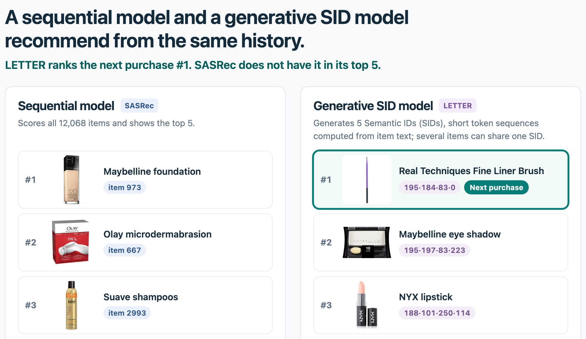

# Cornac Workbench

**Cornac Workbench** is a web application for comparing **sequential recommenders** with **generative recommenders that use Semantic IDs** (SIDs) on the same purchase history. It accompanies the [Cornac](https://github.com/PreferredAI/cornac) framework. All recommendations were computed offline with Cornac models and are served as static files, so the workbench runs in the browser without a server or GPU.

### Quick Links

[Live demo](https://cornac-workbench.preferred.ai) |
[One-minute video](https://cornac-workbench.preferred.ai/video/) |
[Cornac](https://github.com/PreferredAI/cornac) |
[Cornac documentation](https://cornac.readthedocs.io/en/stable/index.html) |
[Preferred.AI](https://preferred.ai/)

[](https://github.com/PreferredAI/cornac-workbench/actions/workflows/deploy.yml)



<p align="center"><i>SASRec (left) and LETTER (right) on the same 16-item Amazon Beauty history, after the shopper's real next purchase has been revealed: LETTER lists it first, SASRec does not list it</i></p>


## What the workbench shows

A Semantic-ID model gives each item a short sequence of discrete tokens, its SID, and recommends by generating the SID of the next item. Several items can share one SID, so a generated SID does not say which item to show. In the Amazon Beauty data used here, the first SID that LETTER generates for the default history is shared by 1,643 items.

The workbench makes this visible on real purchase histories. It opens on a five-step tour with SASRec and LETTER on the default history; *Next* and *Back*, or the step names at the top, move between steps, and *Skip tour* goes straight to the full workbench. *Preliminaries*, before step 1, shows how each kind of model reads a purchase history: a sequential model reads item IDs, and a generative SID model translates each item into a few semantic tokens, from general to specific. With TIGER, two items that share the first token are in the same top-level category 84% of the time, against 23% for two random items.

1. **Shopper.** The user's 16 purchases are shown as photos, with the question "Which item did this user buy next? Pick one." and four item cards: the real next purchase, held out from the Amazon Beauty test set, and three other items from the two models' lists. After you pick one, or press *Show the answer*, the page marks the next purchase (a fine-liner brush) and your guess. A menu switches to the other five histories.
2. **Two recommenders.** The two models' top 5 side by side. SASRec scores all 12,068 items; LETTER generates five SIDs, and each SID is shown as one of its items. SASRec's items show their item IDs and LETTER's their SIDs. For the default history, LETTER lists the brush first and SASRec does not list it.
3. **SID to item.** LETTER predicted the brush's SID, but 1,643 items share it. One row per generated SID gives the number of items that share it and the item that the *resolver* shows. Two switches choose the resolver: one item or all items per SID, and the most similar item (to the history, by Sentence-T5 text embeddings) or the most popular one (in the training data). *Show ranking* opens the order within a SID and its categories: the brush is the most similar item and a sunscreen the most popular. Three numbers give LETTER's Recall@5 on all 22,363 held-out test queries: 0.196 at the SID level, 0.017 at the item level, and 0.004 under collision-corrected evaluation (CCE).
4. **Next items.** First, how each model reads a history: items 88 and 610 have the same LETTER SID. Pick one, and it is added to each model's input, as an item ID for SASRec and as a SID for LETTER, with each model's next top 5 below. After either item LETTER reads the same input and generates the same five SIDs, while SASRec's two lists share no item. *Choose items to add* then lets you add up to two items from either list; a line says what changed, for example "SASRec: 4 of 5 items changed. LETTER: same 5 SIDs." after the brush, and *Undo* goes back.
5. **Made with Cornac.** The Cornac experiment behind the screen in a few lines of Python, a Recall@5 chart of all models at the item level, the SID level and under CCE, one line per SID model on how it handles items that share a SID, `pip install cornac`, and a QR code for the Cornac repository. *Open the full workbench* opens the full screen, and *Start over* returns to step 1.

*Open the full workbench* (or *Skip tour*) opens the full screen: the layout of step 4 with four menus above it (sequential model, Semantic-ID model, history, and resolver), so everything can be changed:

- **The models and the history.** Each pair puts a sequential model next to a Semantic-ID model, giving eight pairs. The six starting histories are taken from the Amazon Beauty test set: two were chosen by hand, and four by a script so that the real next purchase is in the first list of LETTER only, of SASRec only, of both, or of neither. Changing a model keeps the history.

  | Sequential models | Semantic-ID models |
  | :---------------: | :----------------: |
  | SASRec, BERT4Rec  | LETTER, TIGER, RPG, DiffGRM |

- **How a SID becomes an item.** The Semantic-ID model's list depends on the resolver:
  - *One item per SID*: one item for each generated SID, the most popular in the training data or the most similar to the history (Sentence-T5 embeddings).
  - *All items per SID*: all items of each SID in turn, ordered by the same two scores. A SID shared by many items can fill the whole list.

  Each SID opens a panel with the items that share it, with their categories. When each SID on screen belongs to one item, as always in the TIGER pairs, a line says that the resolver does not change the list.
- **Links, phones, and the booth.** The address bar keeps the current view, so reloading or sending the link reopens it. A *Try the demo!* card in the bottom-right corner shows a QR code of the site on hover; a click keeps it open. Kiosk mode is `#k=1` at the end of the address (for example <https://cornac-workbench.preferred.ai/#k=1>): after 60 seconds without input, the page plays the first three tour steps with captions and opens the QR card, until someone touches the screen or presses a key.

Below the lists, four tiles give the pair's Recall@5 on all 22,363 held-out test queries: item-level for both models, and SID-level and collision-corrected (CCE) for the Semantic-ID model. *All models* opens a Recall@5 chart of every model, and *Recall and NDCG* adds NDCG@5.


## Run it locally

Building the site needs [Node.js](https://nodejs.org/) (version 24 was used):

```bash
git clone https://github.com/PreferredAI/cornac-workbench.git
cd cornac-workbench/web
npm ci
npm run build
python3 -m http.server 8110 --directory dist
```

Then open <http://127.0.0.1:8110/>. The build uses absolute paths (`/assets/`, `/journeys/`), so it must be served at the root of a host. Python 3.12's `http.server` sends the WebP product photos without an image MIME type; Chromium displays them anyway.

### Diagnostic view

An earlier version of the workbench examines single test queries in more detail. It reads `workbench-assets/bundle.json.gz` through a small local server that uses only the Python standard library. From the repository root, after `npm run build`:

```bash
python3 -S serve_workbench.py
```

Then open <http://127.0.0.1:8080/?view=diagnostics>. The server's API is described in [workbench-api.md](workbench-api.md).


## How it relates to Cornac

Cornac trains and evaluates the models. This repository turns their outputs into the workbench in two steps:

1. **Export.** [`prepare_journeys.py`](prepare_journeys.py) loads the trained Cornac models, runs them on every state that a journey can reach (six starting histories, up to two choices, eight model pairs: 9,627 states in total), and writes the results as JSON: a `manifest.json`, a `catalog.json` of the 2,408 products that the journeys show, and one folder of states per pair. The starting histories are listed in [`journey-seeds.json`](journey-seeds.json); [`select_seeds.py`](select_seeds.py) chose the four after the first two. [`journeys.py`](journeys.py) holds the resolvers that map a SID to items and the checks on the journey graph.
2. **View.** The React application in [`web/`](web) reads these files and runs no model. The files used by the live demo are in [`web/public/journeys/`](web/public/journeys) (about 64.5 MB, of which 15.0 MB are product photos).

Product photos and short names are added afterwards by [`prepare_media.py`](prepare_media.py). It reads the product image links, brands, categories, and prices from the Amazon Beauty 2014 metadata for the 2,408 products that appear in the journeys, and writes 320-pixel WebP thumbnails to `web/public/journeys/thumbs/` and the names, together with the categories of the items in each SID, to `web/public/journeys/media.json`. It changes none of the exported files. [`promote_journeys.py`](promote_journeys.py) replaces `web/public/journeys/` as a whole, so `prepare_media.py` must be run again after a new export is promoted.

The format of the exported files is described in [journeys.md](journeys.md).

### The paper's experiment

[`experiment.py`](experiment.py) runs the Cornac experiment shown in the paper and on step 5 of the tour: `SASRec`, BERT4Rec (`TransformerRec` with the MLM objective), `TIGER` and `LETTER` on Amazon Beauty, with item-level, SID-level and CCE metrics. It contains the paper's code unchanged, plus the lines that load the data, embed the item text with Sentence-T5, and train the small SASRec whose item vectors `LETTER` uses. It needs Cornac 3.1 or later, `torch`, `transformers` and `sentence-transformers`, and takes several hours:

```bash
python experiment.py
```

It uses the settings printed in the paper, not the tuned checkpoints behind the workbench, so its numbers differ from Table 2.


## Repository layout

| Path | Contents |
| :--- | :--- |
| `web/` | React application (`web/src/`), browser tests (`web/tests/`), exported journeys (`web/public/journeys/`), the one-minute video (`web/public/video/`), the scripts that capture the paper figures and record the video (`web/scripts/`), and interface design notes (`web/design/`) |
| `journeys.py`, `prepare_journeys.py`, `select_seeds.py`, `journey-seeds.json`, `promote_journeys.py`, `journeys.md` | Journey export, the starting histories, the checks an export must pass before it replaces the published one, and the export format |
| `prepare_media.py` | Product photos and short names (`web/public/journeys/thumbs/`, `media.json`) |
| `fit_*_asset.py`, `run_*_grid.py`, `finalize_model_campaign.py`, `sasrec_asset.py`, `sasrec-beauty.sbatch`, `asset-run.md` | Training and model selection for BERT4Rec, TIGER, and SASRec |
| `assets/`, `prepare_replay.py`, `prepare_sasrec_replay.py` | Model settings, metrics, and inputs used by the training and diagnostic scripts |
| `workbench.py`, `serve_workbench.py`, `prepare_workbench.py`, `workbench-assets/`, `workbench-api.md` | Diagnostic view and its data |
| `qualification/`, `asset-contract.md` | How the diagnostic cases were selected, and the check of its metrics against Cornac's evaluator |
| `experiment.py` | The Cornac experiment shown in the paper |
| `test_journeys.py`, `test_workbench.py` | Python tests |
| `*-validation.json`, `figures/` | Test results and screenshots |


## Tests

Python tests, from the repository root (build the site first, because one test serves `web/dist`):

```bash
pip install "cornac>=3.1"   # one journey test compares against Cornac's evaluator
python3 -m unittest test_journeys test_workbench -v
```

This runs 17 journey tests and 11 diagnostic-view tests. The other tests need only the standard library. The diagnostic view's metrics are compared with Cornac's evaluator on 216 configurations ([`qualification/selected-oracle-metrics.json`](qualification/selected-oracle-metrics.json)).

Browser tests use [Playwright](https://playwright.dev/) with Chromium (`npx playwright install chromium` once). From `web/`:

```bash
npm run test:journeys   # 71 checks; needs the static server on port 8110
npm run test:browser    # 17 checks; needs serve_workbench.py on port 8080
```

They write their results to `journeys-validation.json` (and the screenshots in `figures/`) and `web-validation.json`.


## Deployment

[`.github/workflows/deploy.yml`](.github/workflows/deploy.yml) builds `web/` and deploys it to Cloudflare on every push to `main` that changes `web/`, following the setup of the [Preferred.AI website](https://github.com/PreferredAI/PreferredAI.github.io). The site is served by a Cloudflare Worker that holds only the static files ([`web/wrangler.jsonc`](web/wrangler.jsonc)). It needs:

- a Worker named `cornac-workbench` with the custom domain `cornac-workbench.preferred.ai`;
- the repository secrets `CLOUDFLARE_API_TOKEN` (with the *Workers Scripts: Edit* permission) and `CLOUDFLARE_ACCOUNT_ID`.


## Reproducing the exported data

The export, training, and preparation scripts are kept as they were run; the one later edit changed the wording of `release_status` in `prepare_journeys.py`. Each script's SHA-256 hash is stored in the files it produced (`exporter_sha256` in the journey manifest, `workbench-assets/manifest.json`, `assets/provenance.json`), so the journey manifest records the hash from before that edit. As a result, the scripts expect to sit at `papers/www2027-demo/` inside the authors' Cornac research tree and read model checkpoints and data splits from its `runs/` directory, which is not distributed. `prepare_workbench.py` and `prepare_replay.py` also contain paths on the authors' cluster. The workbench, the exported data, the diagnostic view, and the tests above run without them.

For the same reason, the `release_status` and `redistribution` fields inside the exported files still carry the wording written at export time, before the public release. The license terms below apply.


## Citation

The workbench is described in *Cornac 3.0: An Open-Source Framework and Interactive Workbench for Sequential and Generative Recommendation* (Jaime Hieu Do, Trung-Hoang Le, Quoc-Tuan Truong, and Hady W. Lauw), submitted to the WWW 2027 Demo track; its citation will be added here. Until then, please cite Cornac:

<details>
  <summary><a href="http://jmlr.org/papers/v21/19-805.html">Cornac: A Comparative Framework for Multimodal Recommender Systems</a>, Salah <i>et al.</i>, Journal of Machine Learning Research, 21(95):1–5, 2020.</summary>

  ```
  @article{salah2020cornac,
    title={Cornac: A Comparative Framework for Multimodal Recommender Systems},
    author={Salah, Aghiles and Truong, Quoc-Tuan and Lauw, Hady W},
    journal={Journal of Machine Learning Research},
    volume={21},
    number={95},
    pages={1--5},
    year={2020}
  }
  ```
</details>


## License

The code is released under the [Apache License 2.0](LICENSE), as is Cornac. The exported journeys, `assets/`, `workbench-assets/`, and `qualification/` contain product titles, item indices, and interaction sequences derived from the Amazon Review Data (2014) Beauty 5-core subset (McAuley *et al.*). The thumbnails in `web/public/journeys/thumbs/` are reduced copies of the product images linked from that dataset's metadata. These data and images remain subject to that dataset's terms.
