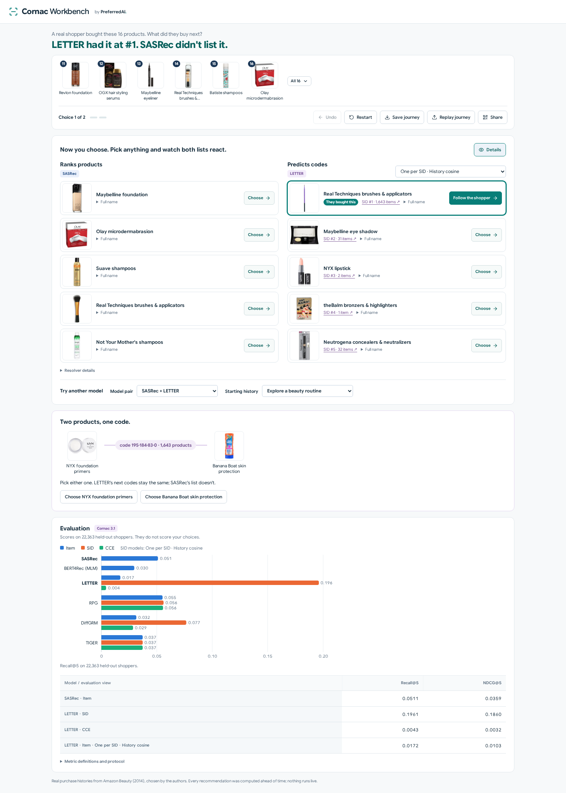

# Cornac Workbench

**Cornac Workbench** is a web application for comparing **sequential recommenders** with **generative recommenders that use Semantic IDs** (SIDs) on the same purchase history. It accompanies the [Cornac](https://github.com/PreferredAI/cornac) framework. All recommendations were computed offline with Cornac models and are served as static files, so the workbench runs in the browser without a server or GPU.

### Quick Links

[Live demo](https://cornac-workbench.preferred.ai) |
[Cornac](https://github.com/PreferredAI/cornac) |
[Cornac documentation](https://cornac.readthedocs.io/en/stable/index.html) |
[Preferred.AI](https://preferred.ai/)

[](https://github.com/PreferredAI/cornac-workbench/actions/workflows/deploy.yml)



<p align="center"><i>SASRec (left) and LETTER (right) recommending from the same 16-item Amazon Beauty history</i></p>


## What the workbench shows

A Semantic-ID model gives each item a short sequence of discrete codes, its SID, and recommends by generating the SID of the next item. Several items can share one SID, so a generated SID does not say which product to show. In the Amazon Beauty data used here, the first SID that LETTER generates for the default history is shared by 1,643 products.

The workbench makes this visible on real purchase histories:

1. **Pick a model pair and a starting history.** Each pair puts a sequential model next to a Semantic-ID model, giving eight pairs. The two starting histories are taken from the Amazon Beauty test set.

   | Sequential models | Semantic-ID models |
   | :---------------: | :----------------: |
   | SASRec, BERT4Rec  | LETTER, TIGER, RPG, DiffGRM |

2. **Choose a product.** Choosing a product from either list adds it to the history, and both models recommend again. A journey allows up to two choices; *Undo* and *Restart* go back.
3. **Change how a SID becomes a product.** The Semantic-ID model's list depends on a policy:
   - *One per SID*: one product for each generated SID, chosen either by training popularity or by cosine similarity to the history (Sentence-T5 embeddings).
   - *Expand buckets*: all products of each SID in turn, ordered by the same two scores. A large bucket can fill the whole list.

   Each SID links to its *bucket*, the list of products that share it.
4. **Save and replay.** *Save journey* downloads the session as a JSON file. *Replay journey* loads it again and rejects a file whose choices or provenance do not match the precomputed states.

Below the lists, each pair shows Recall@5 and NDCG@5 on all 22,363 held-out test queries: item-level values for both models, and SID-level and collision-corrected (CCE) values for the Semantic-ID model.


## Run it locally

Building the site needs [Node.js](https://nodejs.org/) (version 24 was used):

```bash
git clone https://github.com/PreferredAI/cornac-workbench.git
cd cornac-workbench/web
npm ci
npm run build
python3 -m http.server 8110 --directory dist
```

Then open <http://127.0.0.1:8110/>. The build uses absolute paths (`/assets/`, `/journeys/`), so it must be served at the root of a host.

### Diagnostic view

An earlier version of the workbench examines single test queries in more detail. It reads `workbench-assets/bundle.json.gz` through a small local server that uses only the Python standard library. From the repository root, after `npm run build`:

```bash
python3 -S serve_workbench.py
```

Then open <http://127.0.0.1:8080/?view=diagnostics>. The server's API is described in [workbench-api.md](workbench-api.md).


## How it relates to Cornac

Cornac trains and evaluates the models. This repository turns their outputs into the workbench in two steps:

1. **Export.** [`prepare_journeys.py`](prepare_journeys.py) loads the trained Cornac models, runs them on every state that a journey can reach (two starting histories, up to two choices, eight model pairs: 3,470 states in total), and writes the results as JSON: a `manifest.json` plus one folder of states per pair. [`journeys.py`](journeys.py) holds the SID-to-product policies and the checks on the journey graph.
2. **View.** The React application in [`web/`](web) reads these files and runs no model. The files used by the live demo are in [`web/public/journeys/`](web/public/journeys) (about 20 MB).

The format of the exported files is described in [journeys.md](journeys.md).


## Repository layout

| Path | Contents |
| :--- | :--- |
| `web/` | React application (`web/src/`), browser tests (`web/tests/`), exported journeys (`web/public/journeys/`), and interface design notes (`web/design/`) |
| `journeys.py`, `prepare_journeys.py`, `promote_journeys.py`, `journeys.md` | Journey export, the checks an export must pass before it replaces the published one, and the export format |
| `fit_*_asset.py`, `run_*_grid.py`, `finalize_model_campaign.py`, `sasrec_asset.py`, `sasrec-beauty.sbatch`, `asset-run.md` | Training and model selection for BERT4Rec, TIGER, and SASRec |
| `assets/`, `prepare_replay.py`, `prepare_sasrec_replay.py` | Model settings, metrics, and inputs used by the training and diagnostic scripts |
| `workbench.py`, `serve_workbench.py`, `prepare_workbench.py`, `workbench-assets/`, `workbench-api.md` | Diagnostic view and its data |
| `qualification/`, `asset-contract.md` | How the diagnostic cases were selected, and the check of its metrics against Cornac's evaluator |
| `test_journeys.py`, `test_workbench.py` | Python tests |
| `*-validation.json`, `figures/` | Test results and screenshots |


## Tests

Python tests, from the repository root (build the site first, because one test serves `web/dist`):

```bash
pip install "cornac>=3.1"   # one journey test compares against Cornac's evaluator
python3 -m unittest test_journeys test_workbench -v
```

This runs 15 journey tests and 11 diagnostic-view tests. The other tests need only the standard library. The diagnostic view's metrics are compared with Cornac's evaluator on 216 configurations ([`qualification/selected-oracle-metrics.json`](qualification/selected-oracle-metrics.json)).

Browser tests use [Playwright](https://playwright.dev/) with Chromium (`npx playwright install chromium` once). From `web/`:

```bash
npm run test:journeys   # 14 checks; needs the static server on port 8110
npm run test:browser    # 17 checks; needs serve_workbench.py on port 8080
```

They write their results to `journeys-validation.json` (and the screenshots in `figures/`) and `web-validation.json`.


## Deployment

[`.github/workflows/deploy.yml`](.github/workflows/deploy.yml) builds `web/` and deploys it to Cloudflare Pages on every push to `main` that changes `web/`. It follows the setup of the [Preferred.AI website](https://github.com/PreferredAI/PreferredAI.github.io). It needs:

- a Cloudflare Pages project named `cornac-workbench` with the custom domain `cornac-workbench.preferred.ai`;
- the repository secrets `CLOUDFLARE_API_TOKEN` (with permission to edit Cloudflare Pages) and `CLOUDFLARE_ACCOUNT_ID`.


## Reproducing the exported data

The export, training, and preparation scripts are kept exactly as they were run. Each script's SHA-256 hash is stored in the files it produced (`exporter_sha256` in the journey manifest, `workbench-assets/manifest.json`, `assets/provenance.json`), so editing a script would break that record. As a result, the scripts expect to sit at `papers/www2027-demo/` inside the authors' Cornac research tree and read model checkpoints and data splits from its `runs/` directory, which is not distributed. `prepare_workbench.py` and `prepare_replay.py` also contain paths on the authors' cluster. The workbench, the exported data, the diagnostic view, and the tests above run without them.

For the same reason, the `release_status` and `redistribution` fields inside the exported files still carry the wording written at export time, before the public release. The license terms below apply.


## Citation

The workbench is described in *Cornac 3.0: An Open-Source Framework and Interactive Workbench for Sequential and Generative Recommendation* (Jaime Hieu Do, Trung-Hoang Le, Quoc-Tuan Truong, and Hady W. Lauw), submitted to the WWW 2027 Demo track; its citation will be added here. Until then, please cite Cornac:

<details>
  <summary><a href="http://jmlr.org/papers/v21/19-805.html">Cornac: A Comparative Framework for Multimodal Recommender Systems</a>, Salah <i>et al.</i>, Journal of Machine Learning Research, 21(95):1–5, 2020.</summary>

  ```
  @article{salah2020cornac,
    title={Cornac: A Comparative Framework for Multimodal Recommender Systems},
    author={Salah, Aghiles and Truong, Quoc-Tuan and Lauw, Hady W},
    journal={Journal of Machine Learning Research},
    volume={21},
    number={95},
    pages={1--5},
    year={2020}
  }
  ```
</details>


## License

The code is released under the [Apache License 2.0](LICENSE), as is Cornac. The exported journeys, `assets/`, `workbench-assets/`, and `qualification/` contain product titles, item indices, and interaction sequences derived from the Amazon Review Data (2014) Beauty 5-core subset (McAuley *et al.*). These data remain subject to that dataset's terms.
